# Diffusion Time Machine: results

We fine-tune [MVGenMaster](https://github.com/ewrfcas/MVGenMaster) (multi-view diffusion: 3 input photos → new views)
so that it also takes a **capture date** per view, and a per-view **look code** (the colour and tone of the print:
black-and-white, sepia, colour), computed from each photo with no training. Asked for a date, the model should draw
the place **as it was then**; the look code separates "what the place looked like" from "what the photo looks like".

The main model, **ms1**, is trained on **118 landmarks at once** (about 29,000 dated, posed photos from Wikimedia
Commons via MegaScenes, from 1845 to the 2020s) with LoRA adapters, a date embedding and a look embedding added to the timestep
embedding. 11 more landmarks are **held out** (never trained on), and so are 10% of the photos of every training
landmark. Dataset statistics: [`dataset_report.html`](dataset_report.html) (open it in a browser).

Code: `scripts/mvgen/train_multi.py` (training), `src/timemachine/mvgen/` (model, data, evaluation),
`scripts/mvgen/render_path.py` and `scripts/mvgen/render.py` (rendering), `scripts/mvgen/eval_dates.py` (evaluation).
Running notes: [`docs/findings.md`](../docs/findings.md).

## 1. One camera path, two dates: Notre-Dame before and after the 2019 fire

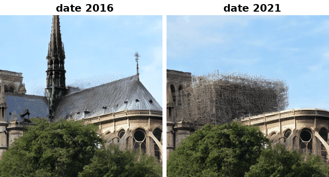

Input: three real photos of the east end, all from **before** the fire (2010, 2017, 2016):

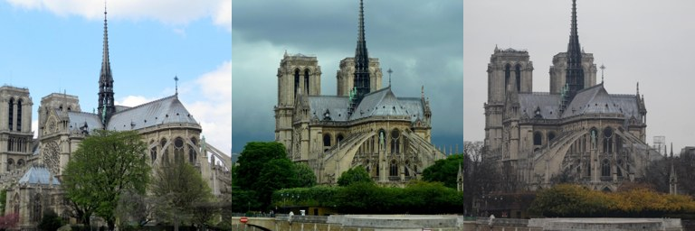

The model generates 21 new views along a smooth path between the inputs' cameras, all in one pass, once at the date
**2016** (left: spire and lead roof) and once at **2021** (right: roof gone, scaffolding over the crossing). Cameras,
noise and look code are identical; only the date changes. Frames are consistent across the path (towers, buttresses,
windows, trees stay in place). Every second frame:

| 2016 | 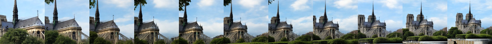 |
|---|---|
| **2021** | 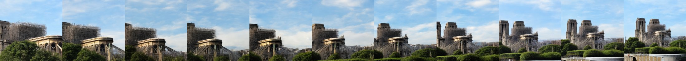 |

Frames and cameras (for 3D reconstruction):
[`data/experiments/mvgen/multi/ms1/notre_dame_apse_path.tar.gz`](../data/experiments/mvgen/multi/ms1/notre_dame_apse_path.tar.gz)
(checkpoint step 135,000; README inside). Limitation: at the date 1850 (before the spire was built in 1859) the model
also draws the after-fire state; it has learned "spire or no spire", not the earlier state.

## 2. The date controls the spire on held-out Notre-Dame photos (step 100,000)

Each column is one camera whose photo was held out of training; rows are the real photo and the model's renders from the
same three input photos and noise, at different dates.

Pre-fire views, from pre-fire inputs (rows: real photo, true date, a date after the fire, an old date). Columns 2, 4, 6:
the spire disappears and scaffolding appears when only the date moves past April 2019; columns 1 and 5 show parts the
fire did not touch, and they do not change:

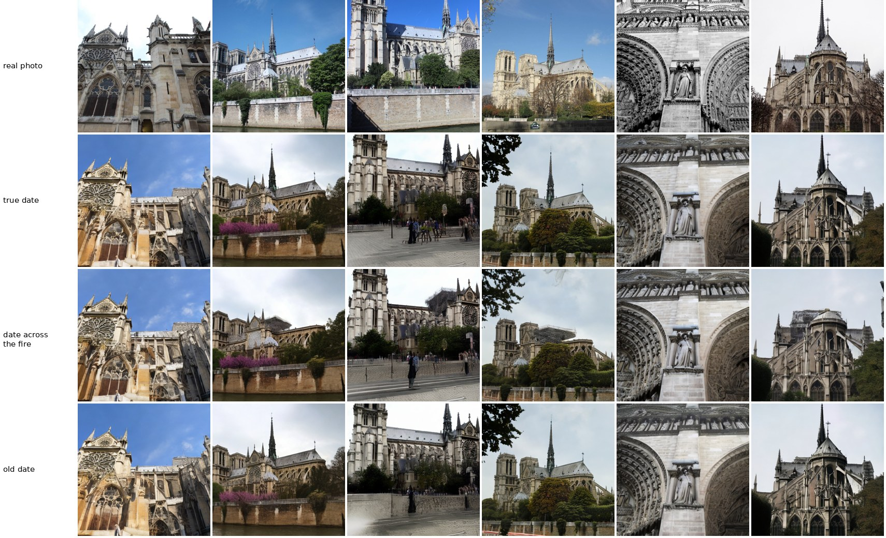

After-fire views, from pre-fire inputs (rows: real photo, true date, a date before the fire). Columns 1, 2, 5: the spire is
rebuilt for a pre-fire date at cameras that only exist in after-fire photos:

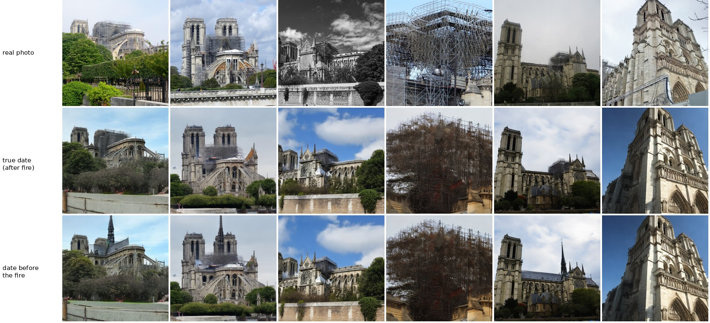

### Numbers (held-out Notre-Dame photos: 67 targets in 22 groups of photos taken by the same photographer on the same day)

| | ms1 10k | ms1 30k | ms1 60k | **ms1 100k** | Notre-Dame-only model (10k) | date only, no look code (10k) |
|---|---|---|---|---|---|---|
| Date flips the fire state (state classifier, logits; higher = stronger) | +0.08 | +0.70 | +2.17 | **+4.11** | +1.81 | +2.13 |
| Wrong date costs more inside the fire region than outside | +0.14% | +0.95% | +2.8% | **+5.7%** | +2.1% | |
| Date changes the photo's look (sd; lower = better) | +0.01 | +0.02 | +0.04 | +0.06 | +0.09 | +0.63 |
| PSNR with the target's own look code | 13.2 dB | 13.8 dB | 14.2 dB | **14.4 dB** | 14.0 dB | |

The multi-landmark model beats the model trained on Notre-Dame alone, on Notre-Dame. The look code keeps the date from
learning the photo's tone (black-and-white, sepia): without it, a date swap shifts the look by +0.63 sd.

## 3. Landmarks the model never trained on

Top row: real photos; the first three are the only input, the last five are hidden from the model (it gets their camera,
date and look code). Bottom row: the model's renders. Step 50,000.

**Opéra Garnier, 1886–1896 views from photos of 1984–2017**, each in its target's print style:

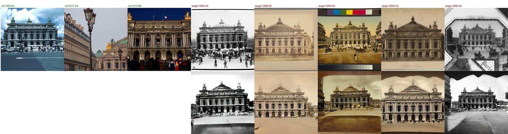

**Sydney Harbour Bridge, 1930–1935 views from photos of 2006–2016**:

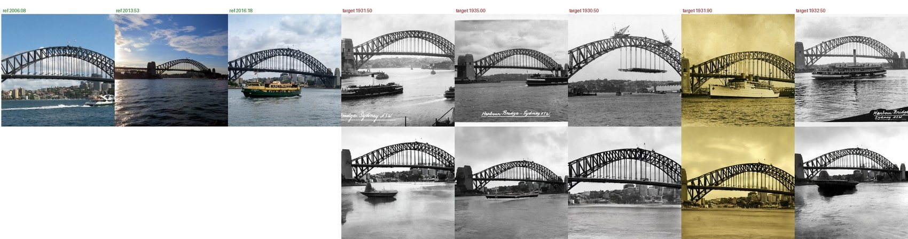

The same views with the look code of the leftmost input (2006) instead: the look code controls the photographic look
independently of the date. It also shows what the date still misses on unseen places: a modern skyline in 1930.

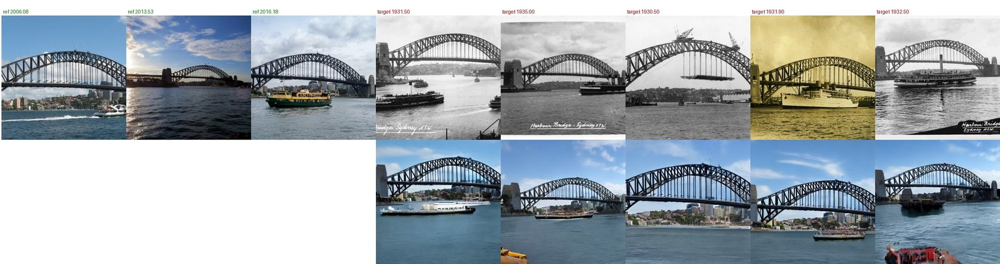

**Great Sphinx of Giza, 2006–2007 views from photos of 1860–1964**:

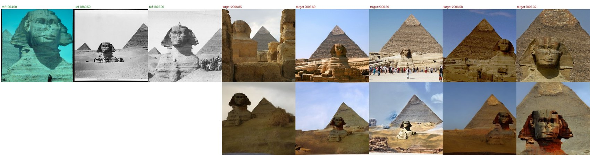

**Vilnius Cathedral, 1937 views from photos of 2013–2019.** A telling mistake: every render keeps the equestrian statue
that was only erected in 1996, copied from the modern inputs. On places it never saw, the date changes tone more than
buildings; Notre-Dame, with dense photos on both sides of a dated change, is where it learned to change the building.

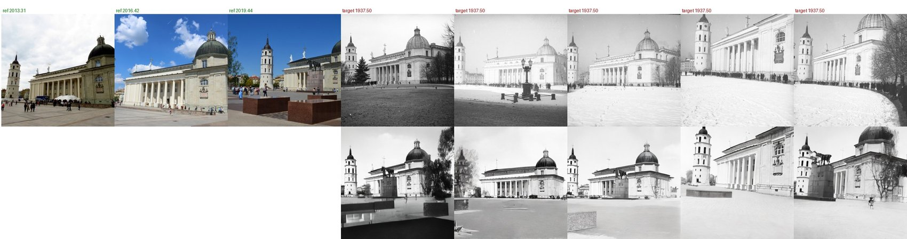

## 4. A training landmark: the Royal Palace of Amsterdam (held-out photos)

Rows: real photos, then renders at the true date, at 1950 and at 2010. Second column: a camera on the National Monument
while it was being built (May 1955). At the true date and at 1950 the model draws an unfinished pillar, at 2010 the
finished monument.

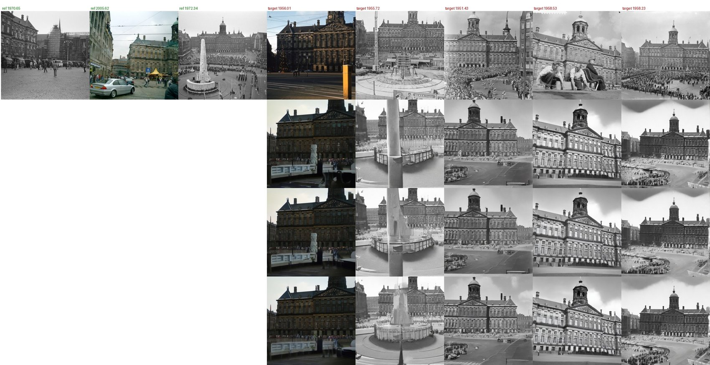
